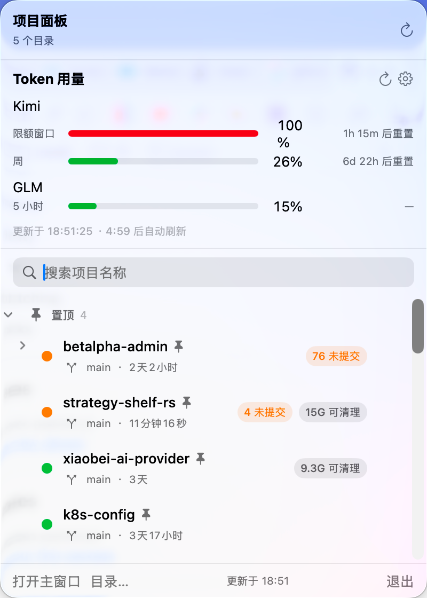
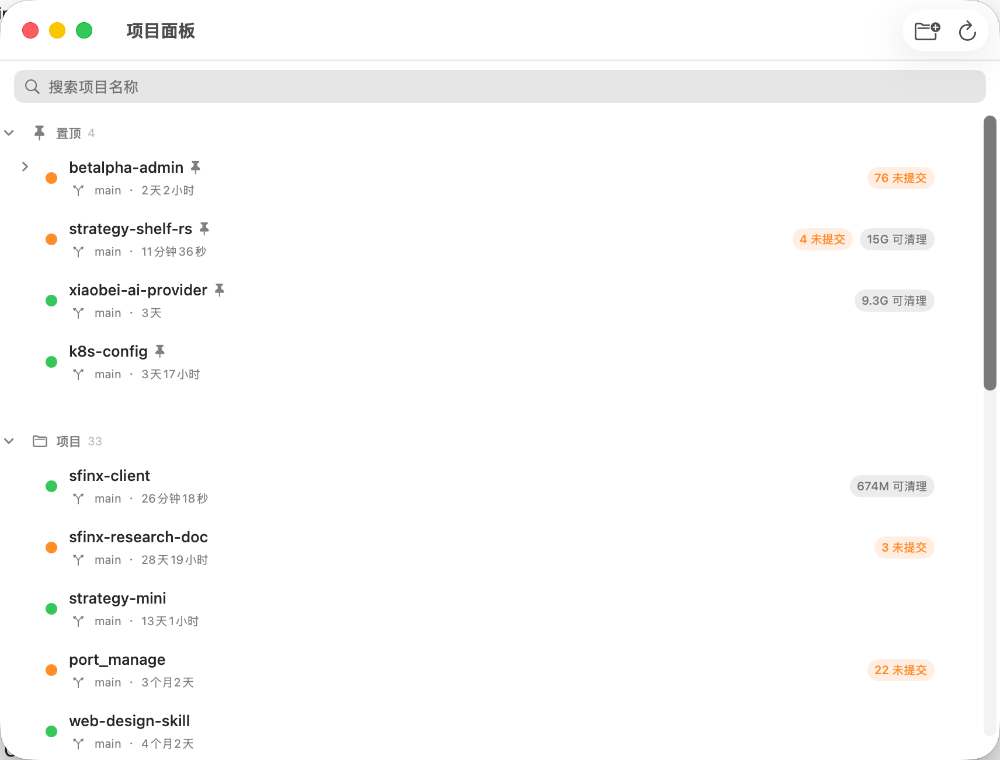

# ProjectDashboard 项目面板

个人自用的 macOS 菜单栏工具：一眼看清本地 git 项目的脏状态、一键清理 Rust 构建产物，并聚合查看 Kimi / GLM 两家 Coding Plan 的 token 用量——不用再逐个打开网页控制台。

纯本地应用（App Sandbox 沙盒），零第三方依赖，Swift 6 + SwiftUI，需要 macOS 14+（以 Apple Silicon 为主，Intel 未测试）。

## 截图

**菜单栏面板**：顶部 Token 用量区块（Kimi 双窗口 + GLM，带重置倒计时与自动刷新），下方为置顶仓库列表。



**主窗口**：搜索过滤 + 置顶/项目分区，每个仓库显示分支、最近提交时间、未提交数、可清理空间等徽章。



## 功能

### 1. Git 仓库监控

- 菜单栏图标实时显示有问题的仓库数量（未提交 / 未推送 / 无远程）
- 点开面板批量查看每个仓库的：分支、未提交数、未推送数、有无 remote、最近提交时间，30 秒自动刷新
- 仓库列表三分区（置顶 / 项目 / 归档），支持搜索过滤、拖拽排序与跨分区移动
- 右键菜单：在 Finder 中显示、在终端打开、置顶、归档
- 扫描目录可随时增删（沙盒授权通过 security-scoped bookmark 持久化）

### 2. Rust 构建产物清理

- 自动检测扫描目录下的 Cargo.toml 与 `target/` 目录，显示占用空间
- 删除前用 `lsof` 检查有无进程占用，确认后才执行；支持 monorepo 一层子项目

### 3. Token 用量聚合

面板顶部的「Token 用量」区块，聚合展示两家 AI 编程订阅的配额：

| 提供商 | 展示内容 |
|---|---|
| Kimi for Coding | 5 小时窗口 + 周窗口两条进度条，各自的重置倒计时（每秒跳动） |
| GLM Coding Plan | 5 小时 Token 窗口进度条（国内版 `open.bigmodel.cn` / 国际版 `api.z.ai` 可切换） |

- 进度条按已用百分比着色：< 50% 绿、50%–85% 黄、> 85% 红
- 面板打开期间每 5 分钟自动刷新（底部显示「更新于 … · X:XX 后自动刷新」），也可手动 ⟳ 强制刷新
- API key 仅存 macOS 钥匙串（Keychain），不落磁盘明文、不写日志
- 认证失败、断网、接口变更等均有中文错误提示（悬停失败图标查看详情）

**首次使用**：点面板上的 ⚙︎（或未配置行的「配置 API Key」按钮）→ 粘贴两家的 key → 保存并刷新。

- **Kimi**：在 [kimi.com/code/console](https://www.kimi.com/code/console) 创建，`sk-kimi-` 开头。注意必须用 Kimi Code 平台的 key，**不是**开放平台（platform.kimi.com）的 key
- **GLM**：在智谱开放平台控制台创建的 Coding Plan API key

## 安装（从源码构建）

本项目没有签名分发渠道，自行从源码构建：

```bash
git clone git@github.com:oryjk/project-dashboard.git
cd project-dashboard
./build-app.sh
```

构建成功后，仓库目录下会生成 `ProjectDashboard.app`，把它拖进 `/Applications`（或 `应用程序`）即完成安装；之后再跑 `./build-app.sh` 会自动同步更新已安装的副本。

### 前置条件

- macOS 14+
- Xcode 16+（或其命令行工具，需带 Swift 6 工具链）：`xcode-select --install` 之后用 `swift --version` 确认是 6.x
- 无需付费开发者账号（见下方签名说明）

### 签名说明（重要）

`build-app.sh` 会优先使用本机的 Apple Development 证书签名；没有任何证书时自动回退为 ad-hoc 签名，应用照常可运行。但 **ad-hoc 签名每次构建都会变化**，而沙盒授权的扫描目录和 Keychain 里保存的 API key 都与签名身份绑定——重新构建后这些配置会失效，需要重新选择目录、重新粘贴 key（不是 bug）。

建议一次性配置免费证书来避免：任意 Apple ID 在 Xcode → Settings → Accounts → Manage Certificates 里创建一张 Apple Development 证书即可，构建脚本会自动使用它，之后重建不再丢配置。

## 开发

```bash
# 编译 + 组装 .app + 签名 + 打入真实 git 二进制
./build-app.sh

# 运行测试（28 个，Swift Testing）
swift test
```

`build-app.sh` 会把 Xcode 开发者目录里的真实 git 二进制打进 `Contents/Resources/`——沙盒内无法使用 Xcode 的 tool-shim git，这是 git 扫描功能正常工作的前提（详见脚本内注释）。

发布流程（个人使用不需要）：

- `./release.sh` — 通用二进制 → Developer ID 签名（hardened runtime）→ 公证 → staple → 输出 zip
- `./release-store.sh` — Apple Distribution 签名 → 打 pkg，供 Transporter 上传 App Store Connect

## 代码结构

```
Sources/ProjectDashboard/
├── ProjectDashboardApp.swift   # 入口：MenuBarExtra 面板 + 主窗口
├── DashboardModel.swift        # git 仓库状态（扫描、分区、刷新调度）
├── GitScanner.swift            # git 子进程调用与状态解析
├── PanelView.swift             # 菜单栏面板骨架
├── RepoListView.swift          # 仓库列表（拖拽、右键、徽章）
├── DirectoryListView.swift     # 扫描目录管理
├── UsageModel.swift            # 用量状态编排（并行查询、5 分钟节流、key 生命周期）
├── UsageProviders.swift        # 用量 Provider 协议 + Kimi/GLM 实现与响应解析纯函数
├── UsageSectionView.swift      # 用量区块 UI + key 设置弹层
└── KeychainStore.swift         # API key 的 Keychain 存取

Tests/ProjectDashboardTests/    # 解析与状态编排的单元测试（真实样本 JSON）
docs/superpowers/               # 设计文档与实现计划
```

**扩展新的用量提供商**：在 `UsageProviders.swift` 里遵守 `UsageProviding` 协议新增一个类型（一个 GET 请求 + 一个响应解析纯函数），加进 `UsageModel` 的默认 providers 数组即可，UI 自动多出一行。

## 已知限制

- 用量查询走的是两家网页控制台的内部接口（智谱官方 Claude Code 插件同样在用），非正式公开 API，理论上可能随服务端变更而失效——失效时面板会显示「获取失败」并给出原因，届时调整对应 Provider 的解析即可
- GLM 接口不返回窗口重置时间，因此 GLM 行的倒计时显示为「—」
- Kimi 的「月度会员额度」需要浏览器扩展配合才能查询，未做

## 数据与隐私

所有数据保存在本机：仓库分区偏好等存 UserDefaults，API key 存 Keychain，无任何遥测与云同步。网络请求仅发生在查询用量时（Kimi / 智谱的 API 域名）。

## 开源协议

[MIT](LICENSE)
